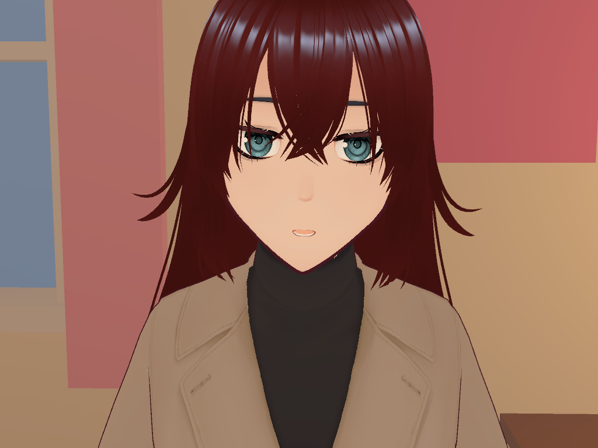
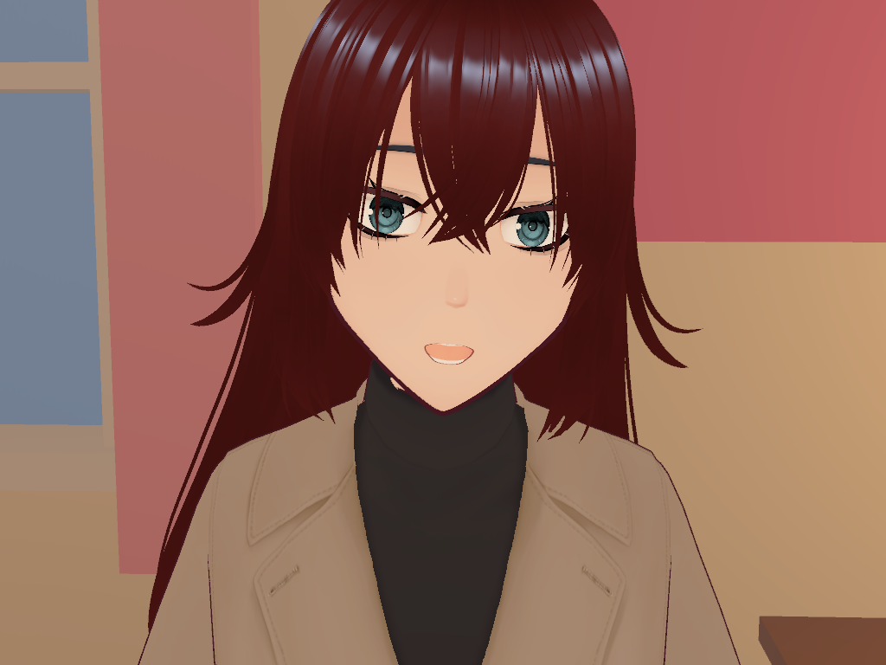
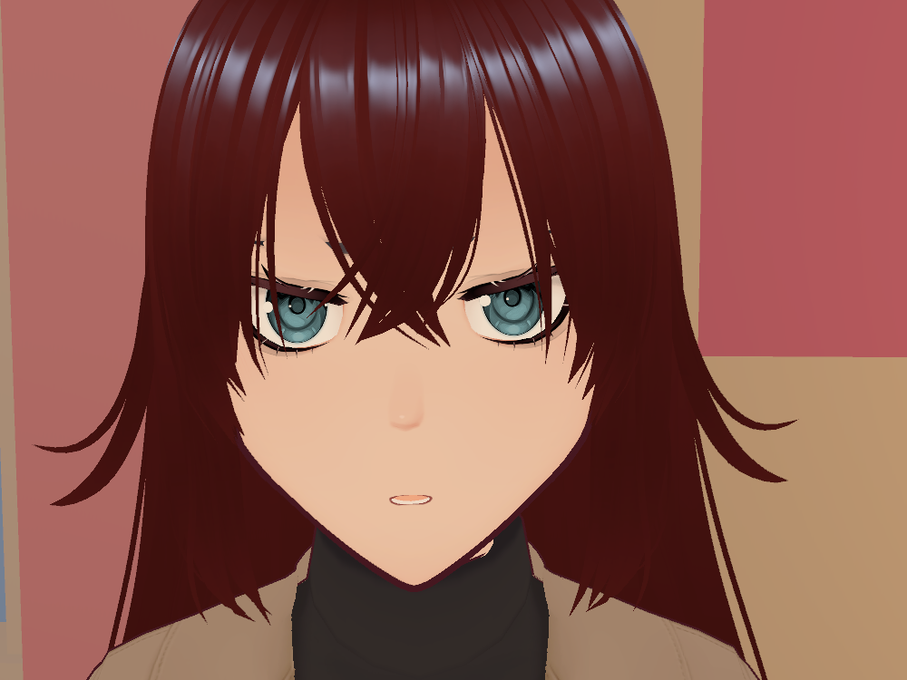
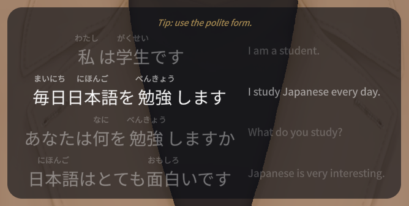
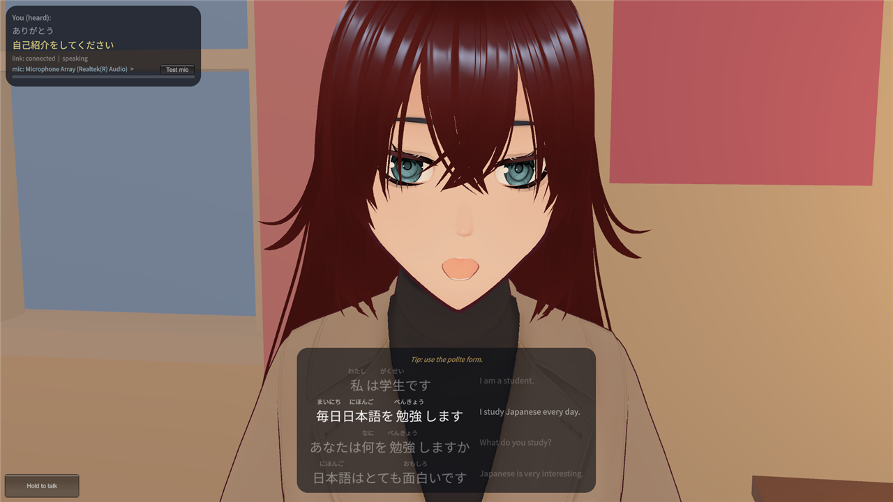

# AMADEUS

Voice-driven Japanese conversation partner with a 3D anime avatar in Unity.

## Screenshots

Automated captures from the Unity test harness, using the developer's own VRM (not included).

| Neutral | Happy | Angry |
|---|---|---|
|  |  |  |
| Default state | Friendly cues | Irritation cues, while speaking |

| Subtitles | Full client |
|---|---|
|  |  |
| Furigana, translation, tip | Transcript, subtitles, controls |

Emotions: keyword cues in the Japanese text and English translation pick the strongest non-neutral match. It is keyword matching, so it can be wrong.

## Features

- Push-to-talk voice chat in Japanese or English.
- Local speech recognition (faster-whisper) and speech synthesis (Kokoro).
- Any OpenAI-compatible chat endpoint (developed against Gemini; local llama.cpp also works).
- Reply lines tagged `[ja]` (spoken), `[en]` (silent tip), `[tr]` (silent translation): `agent/PROTOCOL_SEGMENTS.md`.
- Gentle corrections, one at a time; "quiz me", "teach me <topic>" and shadowing on request.
- VRM 1.0 avatar with lip sync, keyword emotion, idle motion, furigana subtitles, debug panel (F2).
- Optional web search (`ENABLE_WEB_SEARCH=0` turns it off).

## How it works

    Unity client (unity/)  <--- audio (HTTP) / event stream --->  FastAPI agent (agent/)
    mic, avatar, subtitles                                        Whisper STT, Gemini, Kokoro TTS

- Client sends your speech; the agent transcribes it, asks the model, synthesizes the voice.
- Text segments and audio chunks stream back for lip sync and subtitles.
- Client reads agent URL and token from `unity/agent.local.json`.

## Quick start

Config (both routes): copy `agent/.env.example` to `agent/.env`; set `BRAIN_URL`, `BRAIN_MODEL`, `BRAIN_API_KEY` (your Gemini key) and `VOICE_AGENT_TOKEN`. Never commit `.env`.

Agent, Docker (details: `agent/DOCKER.md`):

1. `cd agent`
2. `cp .env.example .env` and edit it
3. `docker compose up --build` (no NVIDIA GPU: add `-f docker-compose.cpu.yml`)

Agent, local (Windows, Python 3.12):

1. `cd agent; python -m venv .venv; .\.venv\Scripts\Activate.ps1; pip install -r requirements.txt` (read the comments in `requirements.txt` first)
2. Copy and edit `.env` as above
3. `powershell -ExecutionPolicy Bypass -File run_local.ps1` (listens on `http://127.0.0.1:5000`)

Unity:

1. Open `unity/` in Unity 6000.6.5f1 (first import fetches UniVRM from GitHub).
2. Put your VRM 1.0 at `Assets/Characters/amadeus.vrm`, or skip it for a placeholder avatar (`unity/Assets/Characters/README.md`).
3. Copy `unity/agent.local.json.example` to `unity/agent.local.json`; set the URL and the same token as `VOICE_AGENT_TOKEN`.
4. Open `Assets/Scenes/Room.unity`, press Play, hold Space and speak.

## Tests and CI

- Agent: `python -m pytest -q` in `agent/` (no GPU, models or network).
- Unity EditMode: `powershell -File unity/tools/unity.ps1 test-edit` (Editor closed).
- End-to-end suite (`agent/e2e/`): needs a GPU and a Gemini key, uses quota, not in CI.
- CI (`.github/workflows/ci.yml`): ruff errors-only lint and pytest with coverage. The Unity job is off; set the repository variable `UNITY_CI=true` and the GameCI secrets `UNITY_LICENSE`, `UNITY_EMAIL`, `UNITY_PASSWORD` to enable it.
- A `v*` tag creates a GitHub Release (`cd.yml`).

## Limitations

- Not a course: no curriculum, no spoken English explanations.
- No progress memory between sessions.
- No pronunciation scoring; she only sees the Whisper transcript.
- Corrections depend on the model and can be wrong.
- Free Gemini tiers are rate limited.
- No avatar model included; the committed scene must be regenerated for yours.
- Strong expressions are capped while she speaks.
- Docker setup is untested.

## Credits

- `agent/` is based on [ManHazz/Voice-Agent](https://github.com/ManHazz/Voice-Agent).
- UniVRM, Kokoro, faster-whisper, Noto Sans JP (SIL Open Font License).
- No `LICENSE` file yet.
